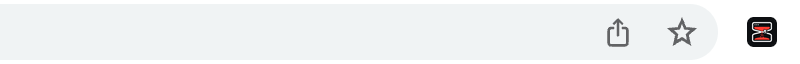
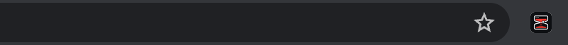

# ScrollTax

**ScrollTax** is a powerful **Chrome/Firefox extension** that puts a tax on doomscrolling — enforce time budgets, block distracting websites, and hold yourself accountable.

## Icon & Appearance





---

## ✨ Features

- **⏱️ Daily Time Limits per Website**: Set fine-grained daily minute budgets for specific domains (e.g., `reddit.com: 20 min`, `youtube.com: 30 min`). Active tab browsing is measured in real-time with visual progress bars. Once your daily budget runs out, the site is immediately blocked.
- **🎯 The "Catch Me" Dodging Button**: To request a time extension on a blocked site, you can't just mindlessly click "Extend". You must catch a randomly moving, dodging button that eludes your mouse cursor.
- **🪞 The Mirror of Accountability**: Catching the button opens a live, mirrored webcam video feed. You must literally face yourself while asking for more screen time.
- **🎙️ Speech-to-Text Phrase Verification**: To unlock an extension, you must verbally repeat a custom phrase (e.g., *"I am wasting my time and I need to get back to work"*) a configured number of times aloud into your microphone.
- **⚡ Local OpenAI Whisper via Apple Silicon MLX**:
  - Runs 100% locally on Apple Silicon using MLX (`mlx-whisper`) leveraging the Neural Engine.
  - Powered by the fast, accurate `mlx-community/whisper-small-mlx` model (~240 MB).
  - 100% private: no audio is ever sent to the cloud.
  - Includes seamless fallback to the browser's built-in Web Speech API if the local Whisper server is offline.
- **⏳ Flexible Extension Options**: Once accountability is verified, choose between **+1 minute**, **+5 minutes**, or **+20 minutes** of additional time.
- **📋 Whitelist Mode (Approved Sites Only)**: Strict productivity mode that blocks all websites except those on your allowed list.
- **📅 Block Schedules**: Automatically enforce blocking during work hours or study times (e.g., Mon–Fri, 9:00 AM – 5:00 PM), with overnight support.
- **🔒 Focus Lock & Disable Cooldown**: Prevent impulsive overrides with a disable countdown timer and timed settings lock.
- **🔎 Advanced Pattern Matching**: Full support for wildcards (`*`, `?`), query string escaping (`\?`), regex rules (`/.../`), and tab title matching (`title:*shorts*`).

---

## 🪞 The Mirror of Accountability & Extension Flow

When a website is blocked (either by a blocking rule or after exceeding your daily time limit):

1. **Catch the Dodging Button**: Click the *"Catch Me for an Extension"* button. As your mouse gets close, the button randomly darts across the screen to break mindless autopilot clicking.
2. **Face Yourself in the Mirror**: Catching the button opens a video modal streaming your webcam in real-time (mirrored for a natural reflection).
3. **Say Your Accountability Phrase**: Click **"Start Speaking"** and repeat your custom phrase aloud the required number of times (e.g., 3 times).
4. **Speech Verification**: The speech-to-text engine processes the audio and verifies that the phrase was spoken completely and accurately.
5. **Choose Your Extension**: Upon successful verification, the extension screen unlocks, allowing you to select **+1 Minute**, **+5 Minutes**, or **+20 Minutes**. The blocked page is unblocked for that duration.

---

## 🎙️ Local OpenAI Whisper (MLX / Apple Silicon) Setup

ScrollTax comes with an integrated, lightweight Python server powered by Apple Silicon MLX and OpenAI's Whisper model (`mlx-community/whisper-small-mlx`, ~240 MB).

### Prerequisites (macOS with Apple Silicon M1/M2/M3/M4)
- Python 3.10+
- `uv` (recommended) or `python3 -m venv`

### Quick Start:

1. **Set up the virtual environment and install dependencies**:
   ```bash
   # Using uv:
   uv venv .venv
   source .venv/bin/activate
   uv pip install mlx-whisper numpy

   # Or standard venv:
   python3 -m venv .venv
   source .venv/bin/activate
   pip install mlx-whisper numpy
   ```

2. **Start the local Whisper server**:
   ```bash
   bash server/start.sh
   # Or directly:
   .venv/bin/python3 server/whisper_server.py
   ```
   The server runs locally at `http://127.0.0.1:8765`.

3. **Verify Connection**:
   - Open the **ScrollTax Options** page in your browser.
   - Under **🪞 The Mirror of Accountability & Speech Verification**, click **"Test Connection"**.
   - You should see a green badge: `🟢 Online (MLX-Whisper)`.

> **Note**: If the local Whisper server is not running, ScrollTax automatically falls back to the browser's native Web Speech Recognition API (`webkitSpeechRecognition`), so the extension remains completely functional.

---

## ⏱️ Daily Time Limits per Website

Configure daily budgets for distracting sites:

1. Open **Options** (`chrome://extensions` -> ScrollTax Options).
2. Under **Daily Time Limits per Website**:
   - Enter a domain (e.g., `reddit.com`, `twitter.com`, `youtube.com`).
   - Enter your daily minute allowance (e.g., `30`).
   - Click **Add / Update Limit**.
3. ScrollTax tracks your active browsing time on that domain in real-time:
   - Green / Yellow / Red visual progress indicator bars.
   - Shows consumed minutes vs. total daily budget.
   - Resets automatically each day at midnight.

---

## 📜 Rule Syntax & Special Characters

```
!           ⇒ prepend to allow / exclude from blocking
*           ⇒ match zero or more characters (e.g. *.example.com/* or *watch*)
?           ⇒ match any single character (e.g. example.com/???/)
\?          ⇒ match literal question mark (e.g. youtube.com/watch\?v=*)
/pattern/   ⇒ standard regular expression (e.g. /.{3,}\.example\.com/)
title:      ⇒ match tab / window title (e.g. title:*Shorts*)
```

### Examples

```
example.com              # Blocks example.com/ and any page on it
example.com/             # Blocks example.com/ ONLY
example.com/*            # Blocks example.com/ and any page on it

example.com/*            # Blocks any page on example.com/
!example.com/orange/     # except example.com/orange/

*.example.com/           # Blocks any subdomain of example.com/
!apple.example.com/      # except apple.example.com/

*watch*                  # Blocks any page containing word "watch"
youtube.com/watch\?v=*   # Blocks specific query strings with literal \?
/.{3,}\.example\.com/    # Blocks subdomains with 3 or more chars via regex
title:*shorts*           # Blocks pages with "shorts" in the tab title
```

---

## ☁️ Cross-Browser Zero-Knowledge Cloud Sync

Keep your blocklists, daily time limits, schedules, and accountability phrases identical across **Opera GX**, **Vivaldi**, **Firefox**, and **Chrome** without creating accounts or logins.

### How It Works:
- **Zero-Knowledge Architecture**: All data is encrypted on your device using client-side **AES-GCM (256-bit)** via the Web Crypto API before transmission. The sync server only stores an encrypted ciphertext blob and never sees your sites or rules.
- **Sync Key**: Your unique Sync Key (e.g. `st_...`) is your private master key. Simply paste the same key into ScrollTax Options in any browser to link them.
- **Free Cloudflare Worker or Local Server**:
  - **Local Network**: Automatically works with the bundled Python server (`http://127.0.0.1:8765/sync`).
  - **Global Cloud (100% Free)**: Deploy `server/sync_worker.js` as a free Cloudflare Worker with KV storage in under 1 minute. Paste your worker URL into ScrollTax Options.

---

## 🛠️ Development & Testing

```bash
# Install dependencies
npm install

# Run unit and integration tests (100% passing)
npm test

# Run ESLint
npm run lint

# Build extension for Chrome and Firefox
npm run build
```

Built extension bundles are placed in:
- `dist/chrome/` — load as unpacked extension in `chrome://extensions`
- `dist/firefox/` — load as temporary extension in `about:debugging`

---

## 🔒 Privacy Notice

- ScrollTax does not collect or transmit any personal data or browsing history.
- All rules, schedules, and daily usage statistics are stored strictly in local browser storage (`chrome.storage.local`).
- Audio recordings used for the Mirror of Accountability are either processed locally on your machine via MLX-Whisper or in your browser, and are never saved or uploaded to external servers.
